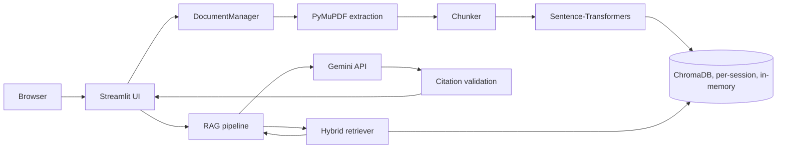

# DocuMind AI

Ask questions about your PDFs and get answers you can verify: every statement is tied to a source file, page number and excerpt. If your documents don't contain the answer, DocuMind says so instead of guessing.

> **Status:** the core app, 101 automated tests and an offline retrieval evaluation exist and pass in the development environment. The production embedding model (sentence-transformers), real Gemini calls, and a public deployment have **not** been exercised yet. See [Verification status](#verification-status).

## Problem statement

Long PDFs (textbooks, policies, papers, reports) are slow to search and chat tools tend to answer fluently even when the document says nothing relevant. DocuMind AI is a retrieval-augmented assistant that prioritises *grounding*: it retrieves passages, answers only from them, cites page numbers, and refuses when evidence is weak.

## Features

* Upload several PDFs (size, page-count and file-count limits), duplicate detection, per-document removal
* Page-aware extraction with PyMuPDF; clear messages for encrypted, corrupted, and scanned/image-only PDFs (no OCR is performed)
* Sentence-aware overlapping chunks that never cross a page, so citations are exact
* Local embeddings (sentence-transformers) + in-memory ChromaDB; hybrid semantic + BM25 retrieval, evidence threshold, near-duplicate removal, per-page diversity cap, optional cross-encoder reranker
* Grounded answers from Gemini with `[S#]` citations validated against the retrieved set; uncited answers are withheld
* Source panel: filename, page, supporting excerpt, plus a statement-to-source mapping with a low-overlap warning
* Study tools: summary, key points, FAQ, quiz (with answers/explanations), downloadable Markdown study guide
* Follow-up questions with short conversation history; multi-document search with optional document scope
* Concise/detailed answer toggle, copyable answers, session clearing, privacy notice
* Safeguards: prompt-injection hardening, output sanitising, per-session and global rate limits, idle-session purge

## Screenshots

_Placeholders: add real screenshots after running the app locally (none have been captured yet)._

| Landing page | Chat with citations | Study tools |
|---|---|---|
| `docs/img/landing.png` | `docs/img/chat.png` | `docs/img/study.png` |

## Architecture



More detail and a sequence diagram: [`docs/architecture.md`](docs/architecture.md).

## How the RAG pipeline works

1. **Extract**: PyMuPDF reads each page in memory; text is cleaned (hyphenation, whitespace).
2. **Chunk**: sentence-aware chunks (`CHUNK_SIZE` characters, `CHUNK_OVERLAP` overlap) within a page, each tagged with filename, page and a random document ID.
3. **Embed + store**: local MiniLM embeddings go into a per-session in-memory ChromaDB collection.
4. **Retrieve**: the question is embedded; semantic top-`FETCH_K` is fused with BM25 keyword hits (reciprocal rank fusion), optionally reranked, filtered by `MIN_SIMILARITY`, de-duplicated and capped per page. Short follow-ups inherit the previous question's topic for retrieval.
5. **Gate**: if nothing clears the threshold, the app answers "not found in your documents" **without calling the LLM**.
6. **Generate**: Gemini receives numbered passages (as untrusted data) and must return JSON with a status, an answer with `[S#]` citations and any limitations.
7. **Validate**: citations that don't map to a retrieved passage are removed; an answer with no valid citation is shown as unverified instead of as fact.

## Tech stack

Python · Streamlit · PyMuPDF · sentence-transformers (`all-MiniLM-L6-v2` by default) · ChromaDB · Google Gen AI SDK (`google-genai`) with Gemini · Pydantic · python-dotenv · pytest

> New to this? Follow the step-by-step [`SETUP_GUIDE.md`](SETUP_GUIDE.md).

## Installation

Requires Python 3.11+ (developed and tested on 3.13; 3.11/3.12 are covered by the CI workflow but were not run locally).

**macOS / Linux**

```bash
git clone <your-repo-url> documind-ai && cd documind-ai
python3 -m venv .venv
source .venv/bin/activate
pip install -r requirements-dev.txt
cp .env.example .env
```

**Windows (PowerShell)**

```powershell
git clone <your-repo-url> documind-ai; cd documind-ai
py -3.11 -m venv .venv
.venv\Scripts\Activate.ps1
pip install -r requirements-dev.txt
Copy-Item .env.example .env
```

(If script execution is blocked: `Set-ExecutionPolicy -Scope CurrentUser RemoteSigned`.)

The first install downloads PyTorch (CPU wheels via the extra index in `requirements.txt`, a few hundred MB); the embedding model (~90 MB) downloads on first use.

## API key setup

1. Create a key in [Google AI Studio](https://aistudio.google.com/apikey). Check the current free-tier limits and pricing there; nothing here promises it is free or unlimited.
2. Put it in `.env` (never commit this file):
   ```
   GEMINI_API_KEY=your-key
   ```
3. Model names change. The default is `gemini-3.8-flash` (cheaper: `gemini-3.5-flash-lite`); set `GEMINI_MODEL` after checking [Google's model list](https://ai.google.dev/gemini-api/docs/models).

## Run locally

```bash
streamlit run app.py
```

Open http://localhost:8501. Try the synthetic sample in `sample_data/README.md`. Without a key, uploading and indexing still work and the app shows a clear banner when you ask a question.

Offline/demo mode without downloading any model (retrieval is lexical, not semantic):

```bash
EMBEDDING_BACKEND=hashing streamlit run app.py          # PowerShell: $env:EMBEDDING_BACKEND="hashing"; streamlit run app.py
```

## Run the tests

```bash
python -m pytest -q                       # 101 tests; mocked LLM, lexical embedder, no network
python -m eval.run_eval --embedder hashing   # offline retrieval evaluation
```

See [`docs/evaluation.md`](docs/evaluation.md) for methodology, results and limits.

## Deployment (Streamlit Community Cloud)

1. Push the repo to GitHub (commands below). Make sure `.env` is **not** committed.
2. At [share.streamlit.io](https://share.streamlit.io) choose **Create app**, select the repo, branch `main`, main file `app.py`, and pick Python 3.11 or newer in *Advanced settings*.
3. In *Advanced settings → Secrets* paste:
   ```toml
   GEMINI_API_KEY = "your-key"
   ```
   The app reads it from the environment or `st.secrets`; it is never rendered or logged.
4. Deploy. The first boot installs dependencies and downloads the embedding model, so expect a slow cold start. Streamlit exposes the health endpoint `/_stcore/health` (returns `ok`).

**Hosting guidance (verify current limits on your platform)**

* Memory: PyTorch + MiniLM + ChromaDB need roughly 1-2 GB RAM at runtime; free tiers can be tight. If the app is killed, switch to a smaller setup or a host with more memory.
* Storage: assume the filesystem is ephemeral. DocuMind keeps vectors in memory and writes no uploads to disk, so documents are lost on restart by design. Persistent vector storage is a future improvement.
* Cold starts: apps may sleep when idle; the model reload adds delay after waking.
* Cost control: `QUESTIONS_PER_WINDOW`, `GLOBAL_LLM_CALLS_PER_HOUR`, `MAX_UPLOAD_MB` and friends bound usage, but a public app can still consume your Gemini quota. Set billing/quota alerts in Google Cloud.

**Post-deploy checklist**

- [ ] App loads, privacy notice visible, no secrets in page source or logs
- [ ] Upload a small text PDF: shows "Ready", page and passage counts
- [ ] Ask a question the PDF answers: answer has `[S#]` citations; sources show correct file/page/excerpt
- [ ] Ask something the PDF does not cover: app declines instead of guessing
- [ ] Ask a follow-up; try a document-scope selection with two PDFs
- [ ] Upload a scanned PDF, an encrypted PDF, a renamed `.txt`, and a duplicate: each gives a clear message
- [ ] Open the app in a second browser/incognito window: it must not show the first session's documents
- [ ] Remove a document, then ask about it: not found. Click **Clear session**: everything gone
- [ ] Temporarily blank the API key in secrets: friendly "no key" error
- [ ] Generate summary/FAQ/quiz and download the study guide

## Security and privacy

What is implemented (and covered by tests where noted):

* API key only via environment / hosting secrets; `.env.example` has placeholders; `.gitignore` excludes secrets, venvs, PDFs, data and vector files.
* Upload checks: size, page count, file count, PDF header, encrypted/corrupt handling; files are parsed from memory, so filenames never become paths. Display names are sanitised (tested).
* Random 128-bit session IDs and 64-bit document IDs; per-session Chroma collections plus metadata filters (isolation and cross-session deletion are tested).
* Prompt-injection hardening: passages delimited and declared untrusted; injected closing tags stripped (tested); model output sanitised (no images/links/HTML, `$` escaped) before display (tested).
* Rate limits: per session, plus a global hourly cap on Gemini calls; max question length; idle sessions purged.
* Errors shown to users are generic; API errors are mapped without echoing keys; logs contain counts and IDs, not document text or prompts.

Limitations you should be aware of:

* **No authentication.** Isolation relies on unguessable per-session IDs held in Streamlit session state. This is not an account system, and anyone with the running server's memory or operator access could see data.
* **Data leaves the app:** question text and retrieved passages are sent to Google's Gemini API. Review Google's current terms before uploading sensitive material. This app cannot verify deletion on Google's side or in any provider backups.
* Rate limits are in-memory and per process; they reset on restart and do not stop a determined attacker.
* Unhandled-exception tracebacks are written to server logs; review log access on your host.
* A word-overlap "support" score is a heuristic, not proof an answer is faithful. Always check the cited page.
* Prompt-injection defences reduce but cannot eliminate risk.

## Evaluation methodology

Retrieval metrics (Recall@k, MRR, multi-page coverage, abstention trade-off, latency) run offline on a small synthetic dataset; answer-quality metrics (citation correctness, relevance proxy, faithfulness proxy, usage) require `--live`. Only the offline lexical-embedder run has been executed so far; numbers and caveats are in [`docs/evaluation.md`](docs/evaluation.md).

## Verification status

| Area | Status |
|---|---|
| Unit/integration tests (mocked LLM, lexical embedder) | 101 passed on Python 3.13 |
| Streamlit boots, health endpoint | Verified (hashing backend) |
| UI flows (landing, question, sources, errors, clear session) | Verified headlessly with Streamlit `AppTest` |
| Real file-upload widget, layout/CSS, mobile view, clear session (headless Chromium, hashing backend, no API key) | Verified on 21 Oct 2026: upload → "Ready", missing-key error shown, 390 px mobile layout renders, Clear session removes the document |
| Answer + citation rendering and copy button in a real browser | **Not verified** (needs a Gemini key; covered only by mocked tests/`AppTest`) |
| sentence-transformers embedding + reranker | **Not verified** (model hub unreachable in dev environment) |
| Real Gemini calls and the default model name | **Not verified** (no key); model name taken from Google's docs page on 20 Oct 2026 |
| Python 3.11 / 3.12 | **Not verified locally**; CI workflow included |
| Public deployment | **Not done** |

## Troubleshooting

| Symptom | Fix |
|---|---|
| "No Gemini API key is configured" | Set `GEMINI_API_KEY` in `.env` or hosting secrets, restart |
| "quota or rate limit was reached" | Wait, check Google AI Studio quota, or choose a lighter model |
| "model was not found" | Update `GEMINI_MODEL` to a current model ID |
| "embedding model could not be loaded" | First run needs internet to download the model; check proxy/firewall |
| "No extractable text … OCR" | Scanned PDF: run OCRmyPDF first, then upload |
| "password-protected" | Remove the password and re-upload |
| Everything is refused as "not enough evidence" | Lower `MIN_SIMILARITY` (try 0.15-0.2) and check with `eval/run_eval.py` |
| `ModuleNotFoundError: src` | Run commands from the repository root |
| Slow first start / out-of-memory on host | PyTorch + model load; use more RAM or the `hashing` demo backend |

## Future improvements

OCR for scanned PDFs · persistent vector storage and real authentication · streaming answers · larger evaluation set with human-labelled faithfulness · LLM-based query rewriting for follow-ups · table/figure extraction · per-user usage quotas · Docker image

## License

MIT is recommended for a portfolio project (add a `LICENSE` file). Choose differently if you need patent protection (Apache-2.0) or copyleft.

## Acknowledgments

[Streamlit](https://streamlit.io) · [PyMuPDF](https://pymupdf.readthedocs.io) (AGPL-3.0 / commercial licence: review the AGPL implications if you distribute or host modified versions) · [Sentence-Transformers](https://www.sbert.net) and the `all-MiniLM-L6-v2` model (Apache-2.0) · [ChromaDB](https://www.trychroma.com) · [Google Gen AI SDK](https://github.com/googleapis/python-genai) and Gemini · [Pydantic](https://docs.pydantic.dev) · [python-dotenv](https://github.com/theskumar/python-dotenv) · [pytest](https://pytest.org)
