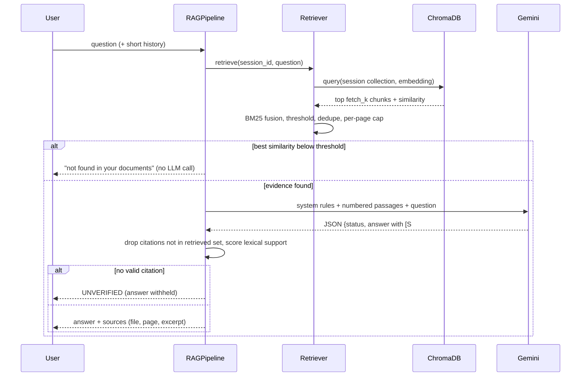

# DocuMind AI - Architecture

## Component diagram

```mermaid
flowchart LR
    U[User browser] --> UI[Streamlit UI<br/>app.py]
    UI -->|upload bytes| DM[DocumentManager<br/>limits, dedupe, lifecycle]
    DM --> PDF[pdf_processor<br/>PyMuPDF, page-aware]
    PDF --> CH[text_chunker<br/>sentence-aware + overlap]
    CH --> EMB[Embedder<br/>sentence-transformers<br/>local CPU]
    EMB --> VS[(ChromaDB<br/>in-memory,<br/>one collection per session)]
    UI -->|question| RAG[RAGPipeline]
    RAG --> RET[Retriever]
    RET --> EMB
    RET --> VS
    RET -->|"semantic + BM25 (RRF),<br/>threshold, dedupe, page cap"| RAG
    RAG -->|"numbered passages<br/>(untrusted data)"| LLM[GeminiService<br/>google-genai]
    LLM --> RAG
    RAG --> CIT[citations<br/>validate [S#] markers]
    CIT --> UI
    UI --> ST[StudyTools<br/>summary / key points / FAQ / quiz]
    ST --> VS
    ST --> LLM
```

## Question-answering sequence



## Modules

| Module | Responsibility |
|---|---|
| `config.py` | Environment-driven settings (frozen dataclass), validation |
| `src/security.py` | Filename sanitising, random IDs, upload checks, rate limiter, secret redaction, markdown sanitising |
| `src/pdf_processor.py` | In-memory PyMuPDF extraction per page; encrypted/corrupt/image-only handling |
| `src/text_chunker.py` | Page-bounded, sentence-aware chunks with overlap |
| `src/embeddings.py` | `SentenceTransformerEmbedder` (production) and `HashingEmbedder` (offline/tests, not semantic) |
| `src/vector_store.py` | ChromaDB wrapper; per-session collection + `session_id` metadata filter |
| `src/retriever.py` | Hybrid retrieval, optional reranker, evidence gate, dedupe, per-page cap |
| `src/llm_service.py` | Gemini client, typed errors, global hourly call cap |
| `src/rag_pipeline.py` | Orchestration, prompt construction, response validation |
| `src/citations.py` | `[S#]` parsing/validation, excerpts, lexical support score |
| `src/document_manager.py` | Session registry, ingest limits, duplicate detection, deletion, idle purge |
| `src/study_tools.py` | Summary, key points, FAQ, quiz, Markdown study guide |
| `src/container.py` | Dependency wiring |
| `app.py` | Streamlit UI |

## Design decisions

* **Page-bounded chunks.** A chunk never crosses a page, so every citation has an exact page number.
* **Evidence gate before the LLM.** If the best semantic similarity is below `MIN_SIMILARITY`, the app refuses without calling Gemini: it saves quota and removes the chance of an ungrounded guess.
* **Citations are validated, not trusted.** The model cites `[S1]`-style numbers; any number that does not map to a retrieved passage is removed, and an answer with zero valid citations is withheld (`UNVERIFIED`). The "support" score is plain word overlap, a sanity signal rather than proof of faithfulness.
* **Untrusted documents.** Passages are wrapped in delimiter tags (injected closing tags are stripped), the system prompt declares them data, and model output is sanitised (no images, links, HTML) before rendering to block exfiltration via rendered markdown.
* **Isolation.** Each browser session gets an unguessable 128-bit ID and its own in-memory Chroma collection; every query also filters on `session_id`. There are no accounts; this is isolation by capability (knowing the ID), not authentication.
* **Ephemeral by design.** In-memory vector store, no files written; data disappears on restart, deletion, or idle timeout. This suits free hosting with an ephemeral filesystem.
* **Lexical fallback embedder.** `HashingEmbedder` exists so tests and CI run without downloading model weights. The UI shows a "Demo mode" warning when it is active.
